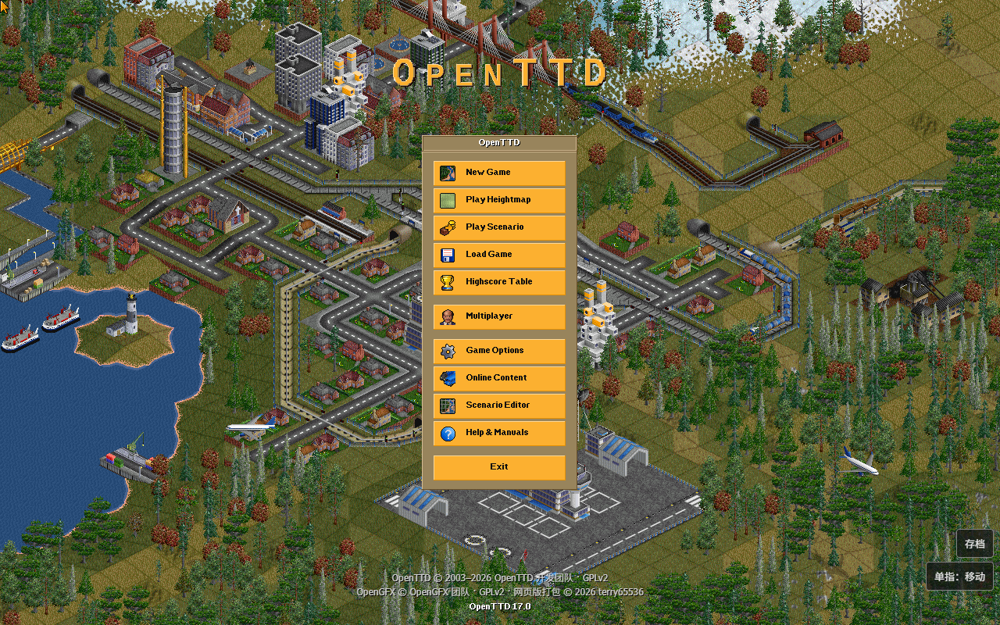

# OpenTTD 单文件网页版（触屏适配）

把完整的 OpenTTD 17.0 编译进 **一个 HTML 文件**：游戏引擎、图形素材、语言文件和 AI 全部内联，双击即可在浏览器里离线运行，不需要安装、不需要服务器。

在线试玩：<https://terry65536.github.io/openttd-html/>

- 版本：OpenTTD 17.0（master 快照，2026-11-08）
- 文件：`OpenTTD.html`（约 25 MB）
- 浏览器：Edge / Chrome 桌面版；Windows 触屏平板可用
- 打包与触屏适配：terry65536



## 开始游戏

1. 双击 `OpenTTD.html`，用 Edge 或 Chrome 打开。
2. 等待加载（单文件较大，首次约需数秒到十几秒）。
3. 点 `New Game` → `Generate` 开始一张随机地图，或 `Load Game` 读档。

游戏界面为英文，因为本版本没有打包 FreeType 字体引擎，无法渲染中文；地图、机车、产业等游戏内文本来自你选择的语言包（默认英文）。

## 操作

| 操作 | 桌面 | 触屏 |
| --- | --- | --- |
| 移动地图 | 按住右键拖动 | 单指拖动（默认"单指：移动"） |
| 左键（建造/选择） | 鼠标左键 | 点按；建造时先切到"单指：建造"再拖动 |
| 右键（取消/拆除） | 鼠标右键 | 长按约 0.45 秒 |
| 缩放 | 滚轮 | 双指捏合 |
| 平移视角 | 滚轮拖动 / 方向键 | 双指拖动 |
| 菜单 | 点击工具栏 | 点按工具栏 |

右下角按钮：

- `单指：移动` / `单指：建造`：切换单指拖动是平移地图还是模拟按住左键拖拽（铺路、建站等）。
- `存档`：打开存档面板，可把浏览器里的 `.sav` **导出到电脑**，或把电脑上的 `.sav` **导入**浏览器。

## 存档说明

- 游戏内 `File → Save game` 正常可用，存档写入浏览器的 IndexedDB。
- 用 `file://` 直接打开时，部分浏览器可能不保留 IndexedDB；页面右下角的 `存档` 面板提供导出/导入，作为可靠备份手段。
- 网页版弹出"浏览器可能清除数据"的提示属于正常现象。

## 关于这个版本

在原版 OpenTTD Emscripten 构建的基础上做了以下改动：

- **单文件构建**：所有素材由 `--preload-file` 改为 `--embed-file`，并启用 `-sSINGLE_FILE=1`，WASM、OpenGFX、语言文件全部内联进 HTML。
- **分辨率自适应**：启动参数按浏览器窗口计算 `-r 宽x高`（上限 1600×1000，下限 640×480），避免在高分屏上开局就卡。
- **触屏输入层**：原版网页版只支持鼠标；新增单指平移、点按左键、长按右键、双指平移与捏合缩放，以及"单指：建造"切换。
- **中文外壳**：加载/错误提示改为中文，加入启动版权提示。
- **存档面板**：导出/导入 `.sav`，弥补 `file://` 下 IndexedDB 不可靠的问题。
- **禁用调查问卷**：网页版没有同意界面，因此不再询问、也不发送参与统计。
- **IndexedDB 保护**：IndexedDB 不可用时跳过挂载和同步，不再阻塞启动。
- 少量编译兼容性修补（MSVC 2019 的 C++20 解析、fmt 缺少 `<cstdlib>`）。

修改明细见 [THIRD_PARTY_NOTICES.md](THIRD_PARTY_NOTICES.md)。

## 已知限制

- 界面为英文；没有软键盘，需要输入文字时请接键盘（默认名可直接用）。
- 未包含音乐与音效（只有静音驱动）。
- 触屏没有"悬停"，菜单旁的工具提示可能暂时盖住菜单项，点一下即可。
- 联机需要 WebSocket 代理，此版本未验证。
- 浏览器无法直接写本地文件，存档跨会话保存依赖 IndexedDB；建议用 `存档` 面板导出备份。

## 已验证 / 未验证

已在无头 Chrome（桌面尺寸、开启触摸模拟）中验证：启动、新游戏生成、单指平移、触摸点按菜单、触摸保存（打开保存对话框并写入文件）、存档面板列出与导出、IndexedDB 刷新后读档。

未在真实平板上逐项验证：双指捏合缩放、长按右键、导入文件选择框的实际体验、低性能设备上的帧率。

## 从源码构建

源码压缩包：`source/OpenTTD-17.0-web-src.tar.gz`（GPLv2，含本版本全部修改）。

需要 Emscripten（emsdk 7.0.0）、CMake、Ninja，以及宿主编译器（用于 `strgen` 等工具）：

```bash
# 1. 先构建宿主工具
cmake -S . -B build-host -DOPTION_TOOLS_ONLY=ON
cmake --build build-host --target tools

# 2. 交叉编译网页版
emcmake cmake -S . -B build -G Ninja \
  -DHOST_BINARY_DIR=../build-host \
  -DCMAKE_BUILD_TYPE=Release
cmake --build build --target openttd
```

产物为 `build/openttd.html`，单文件即可分发。

## 版权与致谢

- **OpenTTD 17.0** — Copyright © 2003–2026 OpenTTD 开发团队及贡献者，GPLv2。原项目：<https://github.com/OpenTTD/OpenTTD>
- **OpenGFX 8.0** — Copyright © OpenGFX 团队，GPLv2。原项目：<https://github.com/OpenTTD/OpenGFX>
- **SDL 2.32.10** — zlib 许可，Copyright © Sam Lantinga 等。
- **zlib 1.3.2 / libpng 1.6.59 / liblzma 5.4.6 / fmt 11.1.4 / Emscripten** — 各自的开源许可。

完整许可文本在 [`licenses/`](licenses/)，组件清单和修改记录见 [THIRD_PARTY_NOTICES.md](THIRD_PARTY_NOTICES.md)。
